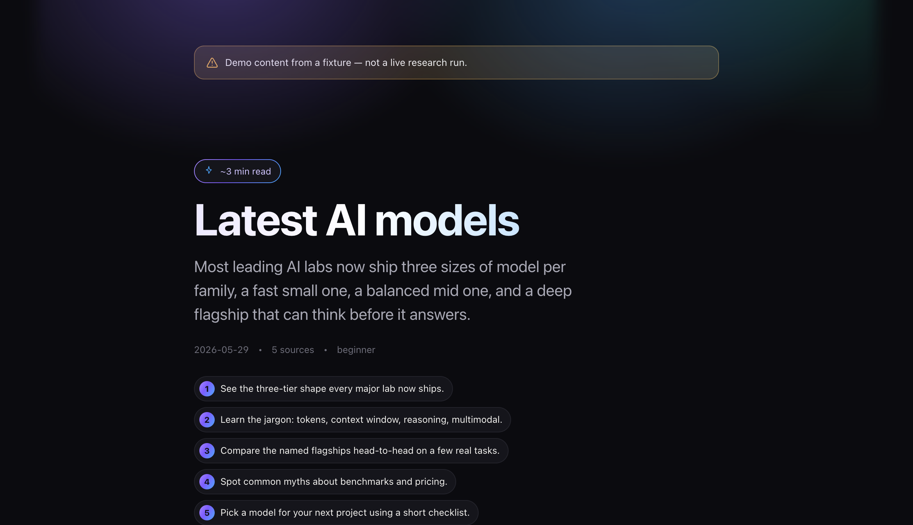

<picture>
  <source media="(prefers-color-scheme: dark)" srcset="https://raw.githubusercontent.com/Aboudjem/recap-studio/main/.github/assets/hero-dark.svg">
  <source media="(prefers-color-scheme: light)" srcset="https://raw.githubusercontent.com/Aboudjem/recap-studio/main/.github/assets/hero-light.svg">
  
</picture>

<p align="center">
  <a href="https://github.com/Aboudjem/recap-studio/releases"></a>
  <a href="LICENSE"></a>
  <a href="https://github.com/Aboudjem/recap-studio/actions/workflows/ci.yml"></a>
</p>

<p align="center">
  <b>English</b> ·
  <a href="READMEs/zh-CN.md">简体中文</a> ·
  <a href="READMEs/ja.md">日本語</a> ·
  <a href="READMEs/es.md">Español</a> ·
  <a href="READMEs/fr.md">Français</a>
</p>

**One page you can email, attach to a PR, or read on a plane.**

Recap Studio turns a topic or a coding session into one HTML page you open with a double-click.

Try it now, with no clone and no install. This is real output from 2026-11-17, with the path shortened:

```bash
npx -y github:Aboudjem/recap-studio demo
```

```text
Verdict: PASS. Wrote /tmp/try/recap-latest-ai-models.html
Page: 49.8 KB, 0 script tags, all CSS inlined. Score: 9.7/10, 0 blocker(s).

Next:
- Open the file with a double-click. It works offline.
- Make your own: `npx -y github:Aboudjem/recap-studio example -o content.json`, edit it, then `npx -y github:Aboudjem/recap-studio render content.json`.
- Score it before you send it: `npx -y github:Aboudjem/recap-studio validate content.json --fail-under 8`.
```



Your lead asks what changed this week. You have 40 commits, a chat log, and no page you can just send.
Or someone asks what a topic means, and you paste ten links.
Recap Studio gives you one file instead. It has no JavaScript and makes no network request.

## Why use it

- **Opens anywhere.** One file, 0 script tags, all CSS inlined. The demo above prints both.
- **Checked before you send it.** Seven offline checks score the page, with no model. Add `--fail-under 8` to refuse a weak page.
- **Recaps your own work.** `/recap session` reads your git diff and commits and turns them into a page your team can read.

The score checks shape, not truth, so read the sources first. Mermaid diagrams show as source offline; use SVG diagrams instead.

## Install

**Claude Code.** Add the 10x marketplace once, then install the plugin:

```bash
claude plugin marketplace add Aboudjem/10x
claude plugin install recap-studio@10x
```

Then type `/recap "What is React Server Components"` in any project.

`claude plugin list` may show "The packages it lists were not installed". It is harmless: the plugin runs from one bundled file and needs no packages.

**Any other agent.** The five skills install with the skills CLI:

```bash
npx skills add Aboudjem/recap-studio
```

**The CLI alone.** No agent needed. It runs from GitHub, not npm:

```bash
npx -y github:Aboudjem/recap-studio render content.json
```

In this README and the docs, `recap` is short for `npx -y github:Aboudjem/recap-studio`. The CLI prints its hints in the form you used to start it.

**An MCP client.** Paste this into your client's MCP config:

```json
{
  "mcpServers": {
    "recap-studio": {
      "command": "npx",
      "args": ["-y", "github:Aboudjem/recap-studio", "mcp"]
    }
  }
}
```

The Claude Code plugin starts this server for you. Per-editor snippets are in [docs/editors.md](docs/editors.md).

<details>
<summary>Other ways in</summary>

```bash
# Pick the agent explicitly
npx skills add Aboudjem/recap-studio -a codex

# The repo's own installer, which calls the same skills CLI
curl -fsSL https://raw.githubusercontent.com/Aboudjem/recap-studio/main/install.sh | bash -s codex

# From a clone, with no network after the clone
git clone https://github.com/Aboudjem/recap-studio && cd recap-studio
node bin/recap.mjs demo
```

Each release also ships `recap-studio.mcpb`, a one-file bundle for MCP clients that install bundles.
</details>

## How it works

1. You ask. `/recap "<topic>"` researches a topic. `/recap session` reads your git diff and commits.
2. Agents write the content. 13 specialist agents find sources, write a five-minute reading path, and check each claim.
3. The agent saves the content as JSON in `artifacts/<slug>/content.json`, in your project.
4. A checker scores it. Seven deterministic checks: structure, citations, word counts, secret scan. No model, no network.
5. The renderer writes one file, `artifacts/<slug>/recap-<slug>.html`. All CSS is inlined.

The CLI and the MCP server are one committed file, `bin/recap.mjs`, with no dependency.

| What runs          | Side effect                                                                                                  |
| :----------------- | :----------------------------------------------------------------------------------------------------------- |
| Skills and agents  | Write files under `artifacts/` in your project. Research uses your agent's own web search, when it has one.                    |
| CLI and MCP server | Write the page you ask for. No network call. 11 MCP tools, listed in [docs/mcp-tools.md](docs/mcp-tools.md). |
| Plugin hooks       | Act only when the session runs inside a recap-studio project (see the FAQ). There they block destructive git and unchecked deploys. They also block writes and edits to secret files. That means `.env` and `.env.*` and anything under `secrets/` or `private/`. It also means SSH key files (`id_rsa`, `id_ed25519`, `id_ecdsa`, `id_dsa`, with or without `.pub`) and `.pem`, `.p12`, `.pfx`, `.keystore` and `.key` files. |
| Deploy and email   | Never run by the plugin. The MCP deploy tool returns a command to run yourself. The email tool returns a draft.  |

## What you get

| Output                 | What it is                                                                                  |
| :--------------------- | :------------------------------------------------------------------------------------------ |
| `recap-<slug>.html`    | One self-contained page. All CSS inlined, zero JavaScript, zero external requests.          |
| `--format md` or `txt` | The same page as Markdown or plain text, for a pull request or a note.                      |
| `--print`              | A paper version: white ground, black text, source URLs spelled out.                         |
| `recap validate`       | A report that opens with the verdict, then up to three fixes, then seven scored dimensions. |
| `--fail-under <score>` | Exit 1 below your gate. A blocker fails the run whatever the score.                         |

## Works with

| Agent                               | What was checked                                                                                | Tested     |
| :---------------------------------- | :---------------------------------------------------------------------------------------------- | :--------- |
| Claude Code 2.1.326                 | Plugin loaded with `--plugin-dir`; its MCP server reported `Connected` from an unrelated folder | 2026-11-17 |
| Codex CLI 0.169.0                   | `codex exec` called the `validate_content` MCP tool and returned the verdict                    | 2026-11-17 |
| Codex, Gemini CLI, OpenCode, Cursor | `npx skills@1.9.0 add` copied all five skills into `.agents/skills/`                            | 2026-11-17 |

Documented, not tested: VS Code (Copilot), Windsurf, Continue, Zed and the other agents the skills CLI supports. Snippets are in [docs/editors.md](docs/editors.md).

## Proof

Each number below comes from a command you can run in a clone.

| Claim                               | Number  | Command                                                                           |
| :---------------------------------- | :------ | :-------------------------------------------------------------------------------- |
| Tests pass                          | 113     | `npm run test:count` (runs `npm test`, prints the total)                          |
| Script tags in a rendered page      | 0       | `node bin/recap.mjs demo`                                                         |
| Demo page size                      | 49.8 KB | `node bin/recap.mjs demo`                                                         |
| Heuristic score of the demo content | 9.7/10  | `node bin/recap.mjs validate fixtures/topics/latest-ai-models.json`               |
| MCP tools                           | 11      | `echo '{"jsonrpc":"2.0","id":1,"method":"tools/list"}' \| node bin/recap.mjs mcp` |

CI runs the suite on Node 20 and 22 on every push and pull request. It also fails if a rendered page holds a `<script>` tag.

## FAQ

**Do I need Claude Code to use it?**
No. The CLI and the MCP server run anywhere Node 20 runs. Claude Code adds the research agents behind `/recap`.

**Does the page call home when I open it?**
No. It has no JavaScript and no external link to load. CI checks every render for a `<script>` tag.

**Is the 9.7/10 score a review by a model?**
No. It is a set of deterministic checks over structure, citations and word counts. It does not read the sources.

**Will the hooks change my other projects?**
No. They check the session's working folder, not the folder of the file being edited. They act only when that folder or a parent has a `recap-studio.config.*` file, a `.recap-studio/` folder, or is this repo. `RECAP_HOOKS_EVERYWHERE=1` turns them on everywhere.

**Why not publish the CLI to npm?**
It does not need it. The CLI is one file with no dependency, so `npx -y github:Aboudjem/recap-studio` runs it directly.

## Limits

- The score is a heuristic. It checks shape, not truth. Read the sources before you share a page.
- Research quality depends on your agent. The CLI renders the content you give it; it does not research.
- Mermaid diagrams do not draw offline. The page shows their source. Use `kind: "svg"` diagrams for a fully visual page.
- Five MCP tools are stubs. `render_page_screenshot`, `run_accessibility_scan` and `run_lighthouse_summary` answer `skipped`: no browser ships with the server. `deploy_vercel_preview` returns a command to run yourself. `send_email_draft` returns a draft.
- The deploy and email tools never deploy or send. Deploy returns a shell command to run yourself. Email returns the draft to paste into your mail client.
- Codex may block the write tools. In a `codex exec` run, its approval review blocked `render_recap_html`. Read tools worked.

## Learn more

- [Editor setup](docs/editors.md), [CLI reference](docs/cli.md), [MCP tools](docs/mcp-tools.md)
- [FAQ](docs/faq.md) and [how it compares](docs/comparison.md)
- [Architecture](docs/architecture.md), [agent system](docs/agent-system.md), [security and privacy](docs/security-and-privacy.md)
- [Changelog](CHANGELOG.md) and [contributing](CONTRIBUTING.md)

---

<p align="center">
  <sub>Built by <a href="https://github.com/Aboudjem">Adam Boudjemaa</a> · MIT License · No telemetry</sub>
</p>
