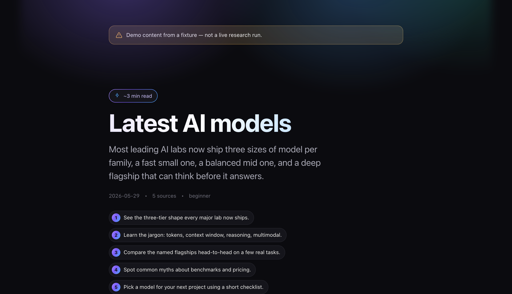

<picture>
  <source media="(prefers-color-scheme: dark)" srcset="https://raw.githubusercontent.com/Aboudjem/recap-studio/main/.github/assets/hero-dark.svg">
  <source media="(prefers-color-scheme: light)" srcset="https://raw.githubusercontent.com/Aboudjem/recap-studio/main/.github/assets/hero-light.svg">
  
</picture>

<p align="center">
  <a href="https://github.com/Aboudjem/recap-studio/releases"></a>
  <a href="LICENSE"></a>
  <a href="https://github.com/Aboudjem/recap-studio/actions/workflows/ci.yml"></a>
</p>

<p align="center">
  <a href="../README.md">English</a> ·
  <a href="zh-CN.md">简体中文</a> ·
  <a href="ja.md">日本語</a> ·
  <b>Español</b> ·
  <a href="fr.md">Français</a>
</p>

**Entiende qué cambió, en una página que puedes enviar.**

Recap Studio hace una página HTML a partir de tu sesión de código o de un tema.

| Entiende lo que se hizo | Una página para enviar | Revisada antes de enviar |
|:--|:--|:--|
| `/recap session` lee tu diff de git y tus commits, y escribe una página. | Un archivo HTML, 0 etiquetas script, todo el CSS dentro. La demo de abajo imprime ambos. | Siete comprobaciones puntúan la página sin modelo; `--fail-under 8` rechaza una página débil. |

**Funciona con:** cualquier agente que lea skills, y cualquier cliente MCP. Probado: Claude Code, Codex CLI. El generador de páginas no necesita modelo, y la escritura usa el modelo de tu agente.

Pruébalo ahora. Solo necesitas Node 20 o posterior.

```bash
npx -y github:Aboudjem/recap-studio demo
```

Salida real del 2026-11-17, con la ruta acortada:

```text
Verdict: PASS. Wrote /tmp/try/recap-latest-ai-models.html
Page: 49.8 KB, 0 script tags, all CSS inlined. Score: 9.7/10, 0 blocker(s).

Next:
- Open the file with a double-click. It works offline.
- Make your own: `npx -y github:Aboudjem/recap-studio example -o content.json`, edit it, then `npx -y github:Aboudjem/recap-studio render content.json`.
- Score it before you send it: `npx -y github:Aboudjem/recap-studio validate content.json --fail-under 8`.
```



La puntuación revisa la forma, no la verdad: lee las fuentes antes de compartir.

## Cuándo usarlo

Tu lead pregunta qué cambió esta semana. Tienes 40 commits y un historial de chat. No tienes ninguna página para enviar.
O alguien pregunta por un tema, y envías diez enlaces.
Recap Studio te da un solo archivo. No tiene JavaScript y no hace ninguna petición de red.
Envíalo por correo, adjúntalo a una pull request o ábrelo en el avión.

## Instalación

**Claude Code.** Añade el marketplace 10x una vez y luego instala el plugin:

```bash
claude plugin marketplace add Aboudjem/10x
claude plugin install recap-studio@10x
```

Después escribe `/recap "What is React Server Components"` en cualquier proyecto.

**Cualquier otro agente.** Las cinco skills se instalan con la CLI skills:

```bash
npx skills add Aboudjem/recap-studio
```

**Solo la CLI.** No hace falta un agente. Se ejecuta desde GitHub, no desde npm:

```bash
npx -y github:Aboudjem/recap-studio render content.json
```

**Un cliente MCP** (una app que llama a herramientas con el Model Context Protocol). Pega esto en su configuración MCP:

```json
{
  "mcpServers": {
    "recap-studio": {
      "command": "npx",
      "args": ["-y", "github:Aboudjem/recap-studio", "mcp"]
    }
  }
}
```

El plugin de Claude Code inicia este servidor por ti. La configuración de cada editor está en [docs/editors.md](../docs/editors.md).

<details>
<summary>Otras formas de instalarlo</summary>

```bash
# Pick the agent explicitly
npx skills add Aboudjem/recap-studio -a codex

# The repo's own installer, which calls the same skills CLI
curl -fsSL https://raw.githubusercontent.com/Aboudjem/recap-studio/main/install.sh | bash -s codex

# From a clone, with no network after the clone
git clone https://github.com/Aboudjem/recap-studio && cd recap-studio
node bin/recap.mjs demo
```

Cada release incluye también `recap-studio.mcpb`, un paquete de un solo archivo para los clientes MCP que instalan paquetes.
</details>

## Cómo funciona

1. Tú preguntas. `/recap "<topic>"` investiga un tema. `/recap session` lee tu diff de git y tus commits.
2. Los agentes escriben el contenido. 13 agentes especializados buscan fuentes, escriben una ruta de cinco minutos y comprueban cada afirmación.
3. El agente guarda el contenido como JSON en `artifacts/<slug>/content.json`, en tu proyecto.
4. Un verificador lo puntúa. Siete comprobaciones fijas dan la misma puntuación cada vez: estructura, citas, número de palabras, búsqueda de secretos. Sin modelo, sin red.
5. El renderizador escribe un solo archivo, `artifacts/<slug>/recap-<slug>.html`. Todo el CSS va incrustado.

La CLI y el servidor MCP son un único archivo versionado, `bin/recap.mjs`, sin dependencias.

| Qué se ejecuta | Efecto secundario |
|:--|:--|
| Skills y agentes | Escriben archivos bajo `artifacts/` en tu proyecto. La investigación usa la búsqueda web de tu agente, si tiene una. |
| CLI y servidor MCP | Escriben la página que pides. Ninguna llamada de red. 11 herramientas MCP, listadas en [docs/mcp-tools.md](../docs/mcp-tools.md). |
| Hooks del plugin | Solo actúan cuando la sesión se ejecuta dentro de un proyecto recap-studio (ver las preguntas frecuentes). Allí bloquean el git destructivo y los despliegues sin revisar. También bloquean la escritura y la edición de archivos secretos. Eso incluye `.env` y `.env.*` y todo lo que esté bajo `secrets/` o `private/`. También incluye las claves SSH (`id_rsa`, `id_ed25519`, `id_ecdsa`, `id_dsa`, con o sin `.pub`) y los archivos `.pem`, `.p12`, `.pfx`, `.keystore` y `.key`. |
| Despliegue y correo | El plugin nunca los ejecuta. La herramienta MCP de despliegue devuelve un comando; la de correo devuelve un borrador. |

## Qué obtienes

| Salida | Qué es |
|:--|:--|
| `recap-<slug>.html` | Una página en un solo archivo. Todo el CSS dentro, cero JavaScript, cero peticiones externas. |
| `--format md` o `txt` | La misma página en Markdown o texto plano, para una pull request o una nota. |
| `--print` | Una versión en papel: fondo blanco, texto negro, URL de las fuentes escritas. |
| `recap validate` | Un informe que empieza por el veredicto, luego hasta tres arreglos, luego siete dimensiones puntuadas. |
| `--fail-under <score>` | Código de salida 1 por debajo de tu umbral. Un bloqueante hace fallar la ejecución sea cual sea la puntuación. |

## Funciona con

| Agente | Qué se probó | Tested |
|:--|:--|:--|
| Claude Code 2.1.326 | Plugin cargado con `--plugin-dir`; su servidor MCP indicó `Connected` desde una carpeta ajena | 2026-11-17 |
| Codex CLI 0.169.0 | `codex exec` llamó a la herramienta MCP `validate_content` y devolvió el veredicto | 2026-11-17 |
| Codex, Gemini CLI, OpenCode, Cursor | `npx skills@1.9.0 add` copió las cinco skills en `.agents/skills/` | 2026-11-17 |

Documentados, sin probar: VS Code (Copilot), Windsurf, Continue, Zed y los demás agentes que admite la CLI skills. Los pasos de configuración están en [docs/editors.md](../docs/editors.md).

## Pruebas

Cada número de abajo sale de un comando que puedes ejecutar en un clon.

| Afirmación | Número | Comando |
|:--|:--|:--|
| Tests que pasan | 113 | `npm run test:count` |
| Etiquetas script en una página renderizada | 0 | `node bin/recap.mjs demo` |
| Tamaño de la página de demo | 49.8 KB | `node bin/recap.mjs demo` |
| Puntuación del contenido de demo | 9.7/10 | `node bin/recap.mjs validate fixtures/topics/latest-ai-models.json` |
| Herramientas MCP | 11 | `echo '{"jsonrpc":"2.0","id":1,"method":"tools/list"}' \| node bin/recap.mjs mcp` |

La CI ejecuta la suite en Node 20 y 22 en cada push y pull request. También falla si una página renderizada contiene una etiqueta `<script>`.

## FAQ

**¿Necesito Claude Code para usarlo?**
No. La CLI y el servidor MCP funcionan donde funcione Node 20. Claude Code añade los agentes de investigación detrás de `/recap`.

**¿La página contacta con algún servidor al abrirla?**
No. No tiene JavaScript ni enlaces externos que cargar. La CI revisa cada renderizado en busca de una etiqueta `<script>`.

**¿La puntuación 9.7/10 viene de un modelo?**
No. Es un conjunto de comprobaciones fijas sobre estructura, citas y número de palabras. Dan la misma puntuación cada vez. No leen las fuentes.

**¿Los hooks cambiarán mis otros proyectos?**
No. Miran la carpeta de trabajo de la sesión, no la carpeta del archivo que se edita. Solo actúan si esa carpeta o una superior tiene un archivo `recap-studio.config.*`, una carpeta `.recap-studio/`, o es este repositorio. `RECAP_HOOKS_EVERYWHERE=1` los activa en todas partes.

**¿Por qué no publicar la CLI en npm?**
No hace falta. La CLI es un solo archivo sin dependencias, así que `npx -y github:Aboudjem/recap-studio` la ejecuta directamente.

## Límites

- La puntuación es una comprobación aproximada (una heurística). Comprueba la forma, no la verdad. Lee las fuentes antes de compartir una página.
- La calidad de la investigación depende de tu agente. La CLI renderiza el contenido que le das; no investiga.
- Sin conexión, los diagramas Mermaid (gráficos escritos como texto) se ven como texto. Usa diagramas SVG en su lugar: `kind: "svg"`.
- Cinco herramientas MCP no hacen todo el trabajo (son esbozos). `render_page_screenshot`, `run_accessibility_scan` y `run_lighthouse_summary` responden `skipped`: el servidor no incluye un navegador. `deploy_vercel_preview` devuelve un comando para ejecutarlo usted. `send_email_draft` devuelve un borrador.
- Las herramientas de despliegue y de correo no despliegan ni envían nada. La primera devuelve un comando para ejecutarlo usted; la segunda devuelve el borrador.
- Codex puede bloquear las herramientas de escritura. En una ejecución de `codex exec`, su revisión de aprobación bloqueó `render_recap_html`. Las de lectura funcionaron.

## Más información

- [Configuración de editores](../docs/editors.md), [referencia de la CLI](../docs/cli.md), [herramientas MCP](../docs/mcp-tools.md)
- [FAQ](../docs/faq.md) y [comparación](../docs/comparison.md)
- [Arquitectura](../docs/architecture.md), [sistema de agentes](../docs/agent-system.md), [seguridad y privacidad](../docs/security-and-privacy.md)
- [Changelog](../CHANGELOG.md) y [cómo contribuir](../CONTRIBUTING.md)

---

<p align="center">
  <sub>Creado por <a href="https://github.com/Aboudjem">Adam Boudjemaa</a> · Licencia MIT · Sin telemetría</sub>
</p>

---

*Esta traducción se ha generado con ayuda de una máquina. Se agradecen los PR de hablantes nativos de español para corregirla y mejorarla. La fuente de referencia definitiva es el README en inglés ([../README.md](../README.md)).*
