<picture>
  <source media="(prefers-color-scheme: dark)" srcset="https://raw.githubusercontent.com/Aboudjem/recap-studio/main/.github/assets/hero-dark.svg">
  <source media="(prefers-color-scheme: light)" srcset="https://raw.githubusercontent.com/Aboudjem/recap-studio/main/.github/assets/hero-light.svg">
  
</picture>

<p align="center">
  <a href="https://github.com/Aboudjem/recap-studio/releases"></a>
  <a href="LICENSE"></a>
  <a href="https://github.com/Aboudjem/recap-studio/actions/workflows/ci.yml"></a>
</p>

<p align="center">
  <a href="../README.md">English</a> ·
  <a href="zh-CN.md">简体中文</a> ·
  <a href="ja.md">日本語</a> ·
  <a href="es.md">Español</a> ·
  <b>Français</b>
</p>

**Comprenez ce qui a changé, dans une page à envoyer.**

Recap Studio fait une page HTML à partir de votre session de code ou d'un sujet.

| Comprendre ce qui a été fait | Une page à envoyer | Vérifiée avant l'envoi |
|:--|:--|:--|
| `/recap session` lit votre diff git et vos commits, puis écrit une page. | Un fichier HTML, 0 balise script, tout le CSS dedans. La démo ci-dessous affiche les deux. | Sept contrôles notent la page sans modèle ; `--fail-under 8` refuse une page faible. |

**Compatible avec :** tout agent qui lit des skills, et tout client MCP (testé : Claude Code, Codex CLI). Le générateur de page n'a besoin d'aucun modèle ; l'écriture utilise le modèle de votre agent.

Essayez maintenant. Il vous faut seulement Node 20 ou plus récent.

```bash
npx -y github:Aboudjem/recap-studio demo
```

Sortie réelle du 2026-11-17, chemin raccourci :

```text
Verdict: PASS. Wrote /tmp/try/recap-latest-ai-models.html
Page: 49.8 KB, 0 script tags, all CSS inlined. Score: 9.7/10, 0 blocker(s).

Next:
- Open the file with a double-click. It works offline.
- Make your own: `npx -y github:Aboudjem/recap-studio example -o content.json`, edit it, then `npx -y github:Aboudjem/recap-studio render content.json`.
- Score it before you send it: `npx -y github:Aboudjem/recap-studio validate content.json --fail-under 8`.
```


**Ce que c'est :** un outil qui fait de votre session de code ou d'un sujet une seule page HTML.

**Quand l'utiliser :** quelqu'un demande ce qui a changé cette semaine, ou ce que veut dire un sujet.

**Ce que vous obtenez :** un fichier à envoyer par e-mail ou à joindre à une pull request. Il s'ouvre hors ligne, sans JavaScript ni requête réseau.

La note vérifie la forme, pas la vérité : lisez les sources avant de partager.

## Installation

**Choisissez votre agent.** Chaque commande installe pour tous vos projets.

[](#claude-code) [![Codex](https://img.shields.io/badge/Codex-000000?style=for-the-badge&logo=data%3Aimage%2Fsvg%2Bxml%3Bbase64%2CPHN2ZyBmaWxsPSJ3aGl0ZSIgcm9sZT0iaW1nIiB2aWV3Qm94PSIwIDAgMjQgMjQiIHhtbG5zPSJodHRwOi8vd3d3LnczLm9yZy8yMDAwL3N2ZyI%2BPHRpdGxlPk9wZW5BSTwvdGl0bGU%2BPHBhdGggZD0iTTIyLjI4MTkgOS44MjExYTUuOTg0NyA1Ljk4NDcgMCAwIDAtLjUxNTctNC45MTA4IDYuMDQ2MiA2LjA0NjIgMCAwIDAtNi41MDk4LTIuOUE2LjA2NTEgNi4wNjUxIDAgMCAwIDQuOTgwNyA0LjE4MThhNS45ODQ3IDUuOTg0NyAwIDAgMC0zLjk5NzcgMi45IDYuMDQ2MiA2LjA0NjIgMCAwIDAgLjc0MjcgNy4wOTY2IDUuOTggNS45OCAwIDAgMCAuNTExIDQuOTEwNyA2LjA1MSA2LjA1MSAwIDAgMCA2LjUxNDYgMi45MDAxQTUuOTg0NyA1Ljk4NDcgMCAwIDAgMTMuMjU5OSAyNGE2LjA1NTcgNi4wNTU3IDAgMCAwIDUuNzcxOC00LjIwNTggNS45ODk0IDUuOTg5NCAwIDAgMCAzLjk5NzctMi45MDAxIDYuMDU1NyA2LjA1NTcgMCAwIDAtLjc0NzUtNy4wNzI5em0tOS4wMjIgMTIuNjA4MWE0LjQ3NTUgNC40NzU1IDAgMCAxLTIuODc2NC0xLjA0MDhsLjE0MTktLjA4MDQgNC43NzgzLTIuNzU4MmEuNzk0OC43OTQ4IDAgMCAwIC4zOTI3LS42ODEzdi02LjczNjlsMi4wMiAxLjE2ODZhLjA3MS4wNzEgMCAwIDEgLjAzOC4wNTJ2NS41ODI2YTQuNTA0IDQuNTA0IDAgMCAxLTQuNDk0NSA0LjQ5NDR6bS05LjY2MDctNC4xMjU0YTQuNDcwOCA0LjQ3MDggMCAwIDEtLjUzNDYtMy4wMTM3bC4xNDIuMDg1MiA0Ljc4MyAyLjc1ODJhLjc3MTIuNzcxMiAwIDAgMCAuNzgwNiAwbDUuODQyOC0zLjM2ODV2Mi4zMzI0YS4wODA0LjA4MDQgMCAwIDEtLjAzMzIuMDYxNUw5Ljc0IDE5Ljk1MDJhNC40OTkyIDQuNDk5MiAwIDAgMS02LjE0MDgtMS42NDY0ek0yLjM0MDggNy44OTU2YTQuNDg1IDQuNDg1IDAgMCAxIDIuMzY1NS0xLjk3MjhWMTEuNmEuNzY2NC43NjY0IDAgMCAwIC4zODc5LjY3NjVsNS44MTQ0IDMuMzU0My0yLjAyMDEgMS4xNjg1YS4wNzU3LjA3NTcgMCAwIDEtLjA3MSAwbC00LjgzMDMtMi43ODY1QTQuNTA0IDQuNTA0IDAgMCAxIDIuMzQwOCA3Ljg3MnptMTYuNTk2MyAzLjg1NThMMTMuMTAzOCA4LjM2NCAxNS4xMTkyIDcuMmEuMDc1Ny4wNzU3IDAgMCAxIC4wNzEgMGw0LjgzMDMgMi43OTEzYTQuNDk0NCA0LjQ5NDQgMCAwIDEtLjY3NjUgOC4xMDQydi01LjY3NzJhLjc5Ljc5IDAgMCAwLS40MDctLjY2N3ptMi4wMTA3LTMuMDIzMWwtLjE0Mi0uMDg1Mi00Ljc3MzUtMi43ODE4YS43NzU5Ljc3NTkgMCAwIDAtLjc4NTQgMEw5LjQwOSA5LjIyOTdWNi44OTc0YS4wNjYyLjA2NjIgMCAwIDEgLjAyODQtLjA2MTVsNC44MzAzLTIuNzg2NmE0LjQ5OTIgNC40OTkyIDAgMCAxIDYuNjgwMiA0LjY2ek04LjMwNjUgMTIuODYzbC0yLjAyLTEuMTYzOGEuMDgwNC4wODA0IDAgMCAxLS4wMzgtLjA1NjdWNi4wNzQyYTQuNDk5MiA0LjQ5OTIgMCAwIDEgNy4zNzU3LTMuNDUzN2wtLjE0Mi4wODA1TDguNzA0IDUuNDU5YS43OTQ4Ljc5NDggMCAwIDAtLjM5MjcuNjgxM3ptMS4wOTc2LTIuMzY1NGwyLjYwMi0xLjQ5OTggMi42MDY5IDEuNDk5OHYyLjk5OTRsLTIuNTk3NCAxLjQ5OTctMi42MDY3LTEuNDk5N1oiLz48L3N2Zz4%3D)](#codex) [](#cursor) [](#gemini-cli) [](#github-copilot) [](#opencode) [](https://skills.sh/aboudjem/recap-studio)

**Tout autre agent** (CLI skills de Vercel) : `npx skills add Aboudjem/recap-studio -g`, puis choisissez votre agent dans son menu. `npx skills` est l'installeur ouvert de Vercel pour les skills. Sa page : [skills.sh/aboudjem/recap-studio](https://skills.sh/aboudjem/recap-studio).

### Claude Code

Testé. Plugin, skills et serveur MCP.

```bash
claude plugin marketplace add Aboudjem/10x
claude plugin install recap-studio@10x
```

Tapez ensuite `/recap "What is React Server Components"` dans n'importe quel projet.

### Codex

Testé : appel MCP. Skills : installation testée.

```bash
npx skills add Aboudjem/recap-studio -g -a codex -y
```

### Cursor

Installation testée.

```bash
npx skills add Aboudjem/recap-studio -g -a cursor -y
```

### Gemini CLI

Installation testée.

```bash
npx skills add Aboudjem/recap-studio -g -a gemini-cli -y
```

### GitHub Copilot

Installation testée.

```bash
npx skills add Aboudjem/recap-studio -g -a github-copilot -y
```

### OpenCode

Installation testée.

```bash
npx skills add Aboudjem/recap-studio -g -a opencode -y
```

Seulement ce projet : retirez `-g`. Un autre agent : mettez son nom après `-a`.

**La CLI seule.** Aucun agent requis. Elle tourne depuis GitHub, pas depuis npm :

```bash
npx -y github:Aboudjem/recap-studio render content.json
```

**Un client MCP** (une app qui appelle des outils via le Model Context Protocol). Collez ceci dans sa configuration MCP :

```json
{
  "mcpServers": {
    "recap-studio": {
      "command": "npx",
      "args": ["-y", "github:Aboudjem/recap-studio", "mcp"]
    }
  }
}
```

Le plugin Claude Code démarre ce serveur pour vous. La configuration de chaque éditeur est dans [docs/editors.md](../docs/editors.md).

<details>
<summary>Autres façons de l'installer</summary>

```bash
# This project only, for the agents the skills CLI finds
npx skills add Aboudjem/recap-studio

# The repo's own installer, which calls the same skills CLI
curl -fsSL https://raw.githubusercontent.com/Aboudjem/recap-studio/main/install.sh | bash -s codex

# From a clone, with no network after the clone
git clone https://github.com/Aboudjem/recap-studio && cd recap-studio
node bin/recap.mjs demo
```

Chaque release fournit aussi `recap-studio.mcpb`, un bundle en un fichier pour les clients MCP qui installent des bundles.
</details>

## Comment ça marche

1. Vous demandez. `/recap "<topic>"` étudie un sujet. `/recap session` lit votre diff git et vos commits.
2. Des agents écrivent le contenu. 13 agents spécialisés trouvent des sources, écrivent un parcours de cinq minutes et vérifient chaque affirmation.
3. L'agent enregistre le contenu en JSON dans `artifacts/<slug>/content.json`, dans votre projet.
4. Un vérificateur le note. Sept contrôles fixes donnent la même note à chaque fois : structure, citations, nombre de mots, recherche de secrets. Ni modèle, ni réseau.
5. Le moteur de rendu écrit un seul fichier, `artifacts/<slug>/recap-<slug>.html`. Tout le CSS est intégré.

La CLI et le serveur MCP sont un seul fichier versionné, `bin/recap.mjs`, sans dépendance.

| Ce qui tourne | Effet de bord |
|:--|:--|
| Skills et agents | Écrivent des fichiers sous `artifacts/` dans votre projet. La recherche utilise la recherche web de votre agent, s'il en a une. |
| CLI et serveur MCP | Écrivent la page demandée. Aucun appel réseau. 11 outils MCP, listés dans [docs/mcp-tools.md](../docs/mcp-tools.md). |
| Hooks du plugin | N'agissent que quand la session tourne dans un projet recap-studio (voir la FAQ). Ils y bloquent le git destructif et les déploiements non vérifiés. Ils bloquent aussi l'écriture et la modification de fichiers secrets. Cela couvre `.env` et `.env.*` et tout ce qui se trouve sous `secrets/` ou `private/`. Cela couvre aussi les clés SSH (`id_rsa`, `id_ed25519`, `id_ecdsa`, `id_dsa`, avec ou sans `.pub`) et les fichiers `.pem`, `.p12`, `.pfx`, `.keystore` et `.key`. |
| Déploiement et e-mail | Jamais lancés par le plugin. L'outil MCP de déploiement renvoie une commande ; celui d'e-mail renvoie un brouillon. |

## Ce que vous obtenez

| Sortie | Ce que c'est |
|:--|:--|
| `recap-<slug>.html` | Une page dans un seul fichier. Tout le CSS dedans, zéro JavaScript, zéro requête externe. |
| `--format md` ou `txt` | La même page en Markdown ou en texte brut, pour une pull request ou une note. |
| `--print` | Une version papier : fond blanc, texte noir, URL des sources en clair. |
| `recap validate` | Un rapport qui commence par le verdict, puis jusqu'à trois corrections, puis sept dimensions notées. |
| `--fail-under <score>` | Code de sortie 1 sous votre seuil. Un bloquant fait échouer l'exécution quel que soit le score. |

## Compatible avec

| Agent | Ce qui a été testé | Tested |
|:--|:--|:--|
| Claude Code 2.1.326 | Plugin chargé avec `--plugin-dir` ; son serveur MCP indiquait `Connected` depuis un dossier sans rapport | 2026-11-17 |
| Codex CLI 0.169.0 | `codex exec` a appelé l'outil MCP `validate_content` et renvoyé le verdict | 2026-11-17 |
| Codex, Gemini CLI, OpenCode, Cursor, GitHub Copilot | `npx skills@1.9.0 add -g` a copié les cinq skills dans `~/.agents/skills/`, pour tous les projets | 2026-11-17 |

Documentés, non testés : Windsurf, Continue, Zed et les autres agents pris en charge par la CLI skills. Les étapes de configuration sont dans [docs/editors.md](../docs/editors.md).

## Preuves

Chaque nombre ci-dessous sort d'une commande que vous pouvez lancer dans un clone.

| Affirmation | Nombre | Commande |
|:--|:--|:--|
| Tests qui passent | 115 | `npm run test:count` |
| Balises script dans une page rendue | 0 | `node bin/recap.mjs demo` |
| Taille de la page de démo | 49.8 KB | `node bin/recap.mjs demo` |
| Score du contenu de démo | 9.7/10 | `node bin/recap.mjs validate fixtures/topics/latest-ai-models.json` |
| Outils MCP | 11 | `echo '{"jsonrpc":"2.0","id":1,"method":"tools/list"}' \| node bin/recap.mjs mcp` |

La CI lance la suite sous Node 20 et 22 à chaque push et pull request. Elle échoue aussi si une page rendue contient une balise `<script>`.

## FAQ

**Faut-il Claude Code pour l'utiliser ?**
Non. La CLI et le serveur MCP tournent partout où Node 20 tourne. Claude Code ajoute les agents de recherche derrière `/recap`.

**La page contacte-t-elle un serveur à l'ouverture ?**
Non. Elle n'a ni JavaScript ni lien externe à charger. La CI vérifie chaque rendu pour une balise `<script>`.

**Le score 9.7/10 vient-il d'un modèle ?**
Non. C'est un ensemble de contrôles fixes sur la structure, les citations et le nombre de mots. Ils donnent la même note à chaque fois. Ils ne lisent pas les sources.

**Les hooks vont-ils modifier mes autres projets ?**
Non. Ils regardent le dossier de travail de la session, pas le dossier du fichier modifié. Ils n'agissent que si ce dossier ou un parent contient un fichier `recap-studio.config.*`, un dossier `.recap-studio/`, ou est ce dépôt. `RECAP_HOOKS_EVERYWHERE=1` les active partout.

**Pourquoi ne pas publier la CLI sur npm ?**
Ce n'est pas nécessaire. La CLI est un seul fichier sans dépendance, donc `npx -y github:Aboudjem/recap-studio` la lance directement.

## Limites

- Le score est un contrôle approximatif (une heuristique). Il vérifie la forme, pas la vérité. Lisez les sources avant de partager une page.
- La qualité de la recherche dépend de votre agent. La CLI rend le contenu fourni ; elle ne fait pas de recherche.
- Hors ligne, les diagrammes Mermaid (des graphiques écrits en texte) s'affichent en texte. Utilisez plutôt des diagrammes SVG : `kind: "svg"`.
- Cinq outils MCP ne font pas tout le travail (ce sont des ébauches). `render_page_screenshot`, `run_accessibility_scan` et `run_lighthouse_summary` répondent `skipped` : aucun navigateur n'est livré avec le serveur.
- Les outils de déploiement et d'e-mail ne déploient ni n'envoient jamais. `deploy_vercel_preview` renvoie une commande shell à lancer vous-même. `send_email_draft` renvoie un brouillon à coller dans votre client mail.
- Codex peut bloquer les outils d'écriture. Lors d'une exécution `codex exec`, sa revue d'approbation a bloqué `render_recap_html`. Les outils de lecture ont fonctionné.

## En savoir plus

- [Configuration des éditeurs](../docs/editors.md), [référence de la CLI](../docs/cli.md), [outils MCP](../docs/mcp-tools.md)
- [FAQ](../docs/faq.md) et [comparaison](../docs/comparison.md)
- [Architecture](../docs/architecture.md), [système d'agents](../docs/agent-system.md), [sécurité et confidentialité](../docs/security-and-privacy.md)
- [Changelog](../CHANGELOG.md) et [contribuer](../CONTRIBUTING.md)

---

<p align="center">
  <sub>Créé par <a href="https://github.com/Aboudjem">Adam Boudjemaa</a> · Licence MIT · Aucune télémétrie</sub>
</p>

---

*Cette traduction a été générée avec l'aide d'une machine. Les PR de locuteurs natifs français pour la corriger et l'améliorer sont les bienvenus. La source de référence définitive est le README en anglais ([../README.md](../README.md)).*
