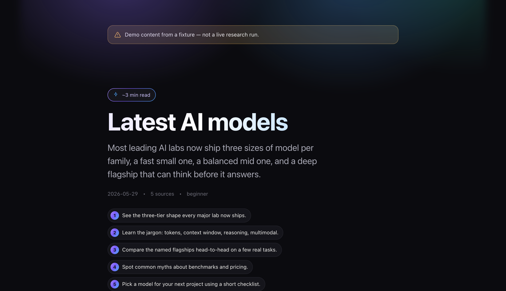

<picture>
  <source media="(prefers-color-scheme: dark)" srcset="https://raw.githubusercontent.com/Aboudjem/recap-studio/main/.github/assets/hero-dark.svg">
  <source media="(prefers-color-scheme: light)" srcset="https://raw.githubusercontent.com/Aboudjem/recap-studio/main/.github/assets/hero-light.svg">
  
</picture>

<p align="center">
  <a href="https://github.com/Aboudjem/recap-studio/releases"></a>
  <a href="LICENSE"></a>
  <a href="https://github.com/Aboudjem/recap-studio/actions/workflows/ci.yml"></a>
</p>

<p align="center">
  <a href="../README.md">English</a> ·
  <a href="zh-CN.md">简体中文</a> ·
  <b>日本語</b> ·
  <a href="es.md">Español</a> ·
  <a href="fr.md">Français</a>
</p>

**メールで送れて、PR に添付できて、飛行機の中でも読める 1 ページ。**

Recap Studio は、トピックやコーディングセッションを、ダブルクリックで開ける 1 つの HTML ページに変えます。

クローンもインストールも不要で今すぐ試せます。2026-11-17 の実際の出力です（パスは短縮）:

```bash
npx -y github:Aboudjem/recap-studio demo
```

```text
Verdict: PASS. Wrote /tmp/try/recap-latest-ai-models.html
Page: 49.8 KB, 0 script tags, all CSS inlined. Score: 9.7/10, 0 blocker(s).

Next:
- Open the file with a double-click. It works offline.
- Make your own: `npx -y github:Aboudjem/recap-studio example -o content.json`, edit it, then `npx -y github:Aboudjem/recap-studio render content.json`.
- Score it before you send it: `npx -y github:Aboudjem/recap-studio validate content.json --fail-under 8`.
```



リードに今週何が変わったかと聞かれます。手元には 40 件のコミットとチャットログがあるだけで、そのまま送れるページはありません。
あるいは、あるトピックの意味を聞かれて、リンクを 10 個貼ることになります。
Recap Studio なら 1 つのファイルで済みます。JavaScript を含まず、ネットワーク通信もしません。

## 使う理由

- **どこでも開けます。** 1 ファイル、script タグ 0 個、CSS はすべてインライン。上のデモが両方を表示します。
- **送る前にチェックされます。** 7 つのオフラインチェックがモデルなしでページを採点します。`--fail-under 8` を付けると弱いページを拒否します。
- **自分の作業もまとめられます。** `/recap session` が git の diff とコミットを読み、チームが読めるページにします。

スコアが見るのは形で、正しさではありません。先にソースを読んでください。オフラインでは Mermaid 図はソースのまま表示されるので、SVG 図を使ってください。

## インストール

**Claude Code。** 10x マーケットプレイスを一度追加し、プラグインをインストールします:

```bash
claude plugin marketplace add Aboudjem/10x
claude plugin install recap-studio@10x
```

その後、任意のプロジェクトで `/recap "What is React Server Components"` と入力します。

**その他のエージェント。** 5 つのスキルは skills CLI でインストールできます:

```bash
npx skills add Aboudjem/recap-studio
```

**CLI のみ。** エージェントは不要です。npm ではなく GitHub から実行します:

```bash
npx -y github:Aboudjem/recap-studio render content.json
```

**MCP クライアント。** クライアントの MCP 設定に次を貼り付けます:

```json
{
  "mcpServers": {
    "recap-studio": {
      "command": "npx",
      "args": ["-y", "github:Aboudjem/recap-studio", "mcp"]
    }
  }
}
```

Claude Code プラグインはこのサーバーを自動で起動します。エディタ別の設定例は [docs/editors.md](../docs/editors.md) にあります。

<details>
<summary>その他のインストール方法</summary>

```bash
# Pick the agent explicitly
npx skills add Aboudjem/recap-studio -a codex

# The repo's own installer, which calls the same skills CLI
curl -fsSL https://raw.githubusercontent.com/Aboudjem/recap-studio/main/install.sh | bash -s codex

# From a clone, with no network after the clone
git clone https://github.com/Aboudjem/recap-studio && cd recap-studio
node bin/recap.mjs demo
```

各リリースには `recap-studio.mcpb` も含まれます。バンドルをインストールできる MCP クライアント向けの 1 ファイル形式です。
</details>

## 仕組み

1. 依頼する。`/recap "<topic>"` はトピックを調べます。`/recap session` は git の差分とコミットを読みます。
2. エージェントが内容を書く。13 の専門エージェントが情報源を探し、5 分で読める構成を書き、各主張を確認します。
3. エージェントが内容を JSON としてプロジェクト内の `artifacts/<slug>/content.json` に保存します。
4. チェッカーが採点する。構造、引用、語数、シークレット検出の 7 つの決定的チェックです。モデルもネットワークも使いません。
5. レンダラーが 1 つのファイル `artifacts/<slug>/recap-<slug>.html` を書き出します。CSS はすべて埋め込みです。

CLI と MCP サーバーは、依存関係のない 1 つのコミット済みファイル `bin/recap.mjs` です。

| 動くもの | 副作用 |
|:--|:--|
| スキルとエージェント | プロジェクト内の `artifacts/` にファイルを書きます。調査にはエージェント自身の Web 検索を使います（ある場合）。 |
| CLI と MCP サーバー | 依頼されたページを書きます。ネットワーク通信なし。MCP ツールは 11 個で、[docs/mcp-tools.md](../docs/mcp-tools.md) に一覧があります。 |
| プラグインのフック | セッションが recap-studio プロジェクト内で動いているときだけ動作します (FAQ を参照)。そこでは破壊的な git と未確認のデプロイを止めます。シークレットファイルへの書き込みと編集も止めます。対象は `.env` と `.env.*`、`secrets/` または `private/` の下にあるものすべてです。SSH 鍵 (`id_rsa`、`id_ed25519`、`id_ecdsa`、`id_dsa`、`.pub` の有無を問わず) と `.pem`、`.p12`、`.pfx`、`.keystore`、`.key` ファイルも対象です。 |
| デプロイとメール | プラグインは実行しません。MCP のデプロイツールはコマンドを返し、メールツールは下書きを返します。 |

## 得られるもの

| 出力 | 内容 |
|:--|:--|
| `recap-<slug>.html` | 自己完結した 1 ページ。CSS はすべて埋め込み、JavaScript ゼロ、外部リクエストゼロ。 |
| `--format md` または `txt` | 同じページを Markdown またはプレーンテキストで。プルリクエストやメモ用です。 |
| `--print` | 印刷用: 白い背景、黒い文字、情報源の URL を明記。 |
| `recap validate` | 判定から始まり、最大 3 つの修正点、7 つの採点項目が続くレポート。 |
| `--fail-under <score>` | しきい値を下回ると終了コード 1。ブロッカーがあればスコアに関係なく失敗します。 |

## 対応エージェント

| Agent | テスト内容 | Tested |
|:--|:--|:--|
| Claude Code 2.1.326 | `--plugin-dir` でプラグインを読み込み、無関係なフォルダから MCP サーバーが `Connected` と表示 | 2026-11-17 |
| Codex CLI 0.169.0 | `codex exec` が MCP ツール `validate_content` を呼び、判定を返した | 2026-11-17 |
| Codex, Gemini CLI, OpenCode, Cursor | `npx skills@1.9.0 add` が 5 つのスキルを `.agents/skills/` にコピーした | 2026-11-17 |

ドキュメントのみ、未テスト: VS Code (Copilot)、Windsurf、Continue、Zed、その他 skills CLI が対応するエージェント。設定例は [docs/editors.md](../docs/editors.md) にあります。

## Proof

以下の数値はすべて、クローン内で実行できるコマンドの出力です。

| 主張 | 数値 | コマンド |
|:--|:--|:--|
| 成功するテスト | 113 | `npm run test:count` |
| 生成ページ内の script タグ | 0 | `node bin/recap.mjs demo` |
| デモページのサイズ | 49.8 KB | `node bin/recap.mjs demo` |
| デモ内容のヒューリスティックスコア | 9.7/10 | `node bin/recap.mjs validate fixtures/topics/latest-ai-models.json` |
| MCP ツール | 11 | `echo '{"jsonrpc":"2.0","id":1,"method":"tools/list"}' \| node bin/recap.mjs mcp` |

CI は push とプルリクエストのたびに Node 20 と 22 でテストを実行します。生成ページに `<script>` タグがあっても失敗します。

## FAQ

**使うのに Claude Code は必要ですか?**
いいえ。CLI と MCP サーバーは Node 20 が動く環境ならどこでも動きます。Claude Code は `/recap` の調査エージェントを追加します。

**ページを開くと外部と通信しますか?**
いいえ。JavaScript も読み込む外部リンクもありません。CI は毎回の出力で `<script>` タグがないことを確認します。

**9.7/10 のスコアはモデルの評価ですか?**
いいえ。構造、引用、語数に対する決定的なチェックの集まりです。情報源は読みません。

**フックは他のプロジェクトに影響しますか?**
いいえ。フックが見るのはセッションの作業フォルダで、編集中のファイルのフォルダではありません。そのフォルダか親フォルダに `recap-studio.config.*` ファイルか `.recap-studio/` フォルダがあるとき、またはこのリポジトリのときだけ動きます。`RECAP_HOOKS_EVERYWHERE=1` で全体に有効化できます。

**なぜ CLI を npm に公開しないのですか?**
その必要がないからです。CLI は依存関係のない 1 ファイルなので、`npx -y github:Aboudjem/recap-studio` で直接実行できます。

## Limits

- スコアはヒューリスティックです。形式を確認するだけで、真偽は確認しません。共有前に情報源を読んでください。
- 調査の質はエージェント次第です。CLI は渡された内容を描画するだけで、調査はしません。
- Mermaid 図はオフラインでは描画されません。ページにはソースが表示されます。完全に視覚的なページには `kind: "svg"` の図を使ってください。
- 5 つの MCP ツールは未実装です。`render_page_screenshot`、`run_accessibility_scan`、`run_lighthouse_summary` は、サーバーにブラウザが含まれないため `skipped` を返します。`deploy_vercel_preview` は自分で実行するコマンドを返します。`send_email_draft` は下書きを返します。
- デプロイとメールのツールは、デプロイも送信もしません。デプロイは自分で実行するコマンドを返し、メールは下書きを返します。
- Codex は書き込みツールをブロックすることがあります。`codex exec` の実行では承認レビューが `render_recap_html` をブロックしました。読み取りツールは動きました。

## 詳しく

- [エディタ設定](../docs/editors.md)、[CLI リファレンス](../docs/cli.md)、[MCP ツール](../docs/mcp-tools.md)
- [FAQ](../docs/faq.md) と [比較](../docs/comparison.md)
- [アーキテクチャ](../docs/architecture.md)、[エージェント構成](../docs/agent-system.md)、[セキュリティとプライバシー](../docs/security-and-privacy.md)
- [Changelog](../CHANGELOG.md) と [コントリビュート](../CONTRIBUTING.md)

---

<p align="center">
  <sub>作者 <a href="https://github.com/Aboudjem">Adam Boudjemaa</a> · MIT ライセンス · テレメトリなし</sub>
</p>

---

*この翻訳は機械の支援により作成されました。日本語ネイティブの方による修正や改善の PR を歓迎します。決定版の参照元は英語版 README ([../README.md](../README.md)) です。*
