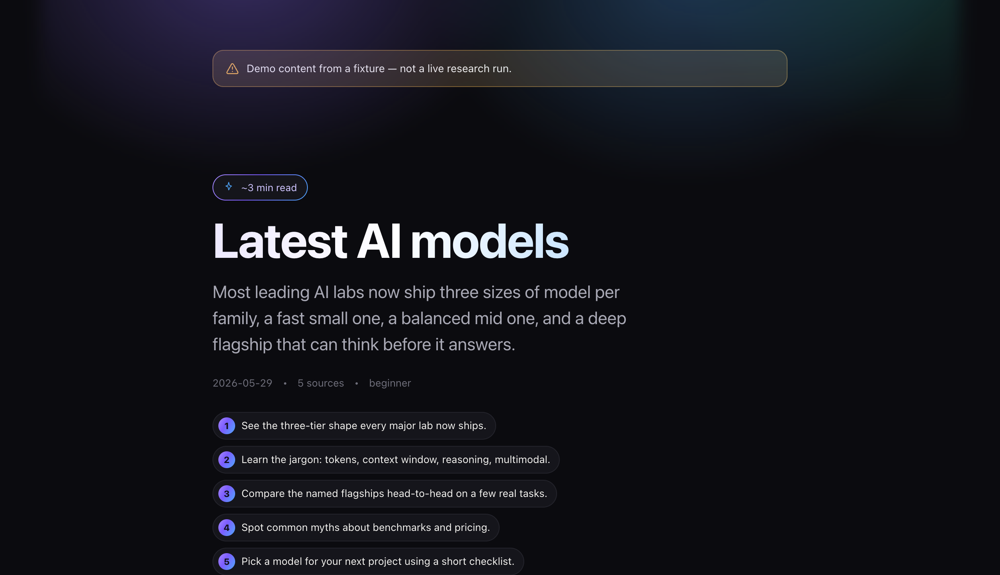

<picture>
  <source media="(prefers-color-scheme: dark)" srcset="https://raw.githubusercontent.com/Aboudjem/recap-studio/main/.github/assets/hero-dark.svg">
  <source media="(prefers-color-scheme: light)" srcset="https://raw.githubusercontent.com/Aboudjem/recap-studio/main/.github/assets/hero-light.svg">
  
</picture>

<p align="center">
  <a href="https://github.com/Aboudjem/recap-studio/releases"></a>
  <a href="LICENSE"></a>
  <a href="https://github.com/Aboudjem/recap-studio/actions/workflows/ci.yml"></a>
</p>

<p align="center">
  <a href="../README.md">English</a> ·
  <b>简体中文</b> ·
  <a href="ja.md">日本語</a> ·
  <a href="es.md">Español</a> ·
  <a href="fr.md">Français</a>
</p>

**一个页面：可以发邮件、附到 PR 上，或在飞机上阅读。**

Recap Studio 把一个主题或一次编码会话变成一个双击即可打开的 HTML 页面。

无需克隆或安装，现在就能试。以下是 2026-11-17 的真实输出（路径已缩短）：

```bash
npx -y github:Aboudjem/recap-studio demo
```

```text
Verdict: PASS. Wrote /tmp/try/recap-latest-ai-models.html
Page: 49.8 KB, 0 script tags, all CSS inlined. Score: 9.7/10, 0 blocker(s).

Next:
- Open the file with a double-click. It works offline.
- Make your own: `npx -y github:Aboudjem/recap-studio example -o content.json`, edit it, then `npx -y github:Aboudjem/recap-studio render content.json`.
- Score it before you send it: `npx -y github:Aboudjem/recap-studio validate content.json --fail-under 8`.
```



你的负责人问这周改了什么。你有 40 个提交、一段聊天记录，却没有一个可以直接发出去的页面。
或者有人问某个主题是什么意思，你贴了十个链接。
Recap Studio 给你的是一个文件。它没有 JavaScript，也不发出任何网络请求。

## 为什么用它

- **到处都能打开。** 一个文件，0 个 script 标签，CSS 全部内联。上面的演示会打印这两项。
- **发出去之前先检查。** 七项离线检查给页面打分，不用模型。加上 `--fail-under 8` 可以拒绝质量差的页面。
- **总结你自己的工作。** `/recap session` 读取你的 git diff 和提交，把它们变成团队能读的页面。

分数检查的是结构，不是真假，所以请先读来源。离线时 Mermaid 图只显示源码；请改用 SVG 图。

## 安装

**Claude Code。** 先添加一次 10x 插件市场，再安装插件：

```bash
claude plugin marketplace add Aboudjem/10x
claude plugin install recap-studio@10x
```

然后在任意项目中输入 `/recap "What is React Server Components"`。

**其他智能体。** 五个技能通过 skills CLI 安装：

```bash
npx skills add Aboudjem/recap-studio
```

**只用 CLI。** 不需要智能体。它从 GitHub 运行，而不是 npm：

```bash
npx -y github:Aboudjem/recap-studio render content.json
```

**MCP 客户端。** 把下面内容粘贴到客户端的 MCP 配置中：

```json
{
  "mcpServers": {
    "recap-studio": {
      "command": "npx",
      "args": ["-y", "github:Aboudjem/recap-studio", "mcp"]
    }
  }
}
```

Claude Code 插件会自动启动这个服务器。各编辑器的配置示例见 [docs/editors.md](../docs/editors.md)。

<details>
<summary>其他安装方式</summary>

```bash
# Pick the agent explicitly
npx skills add Aboudjem/recap-studio -a codex

# The repo's own installer, which calls the same skills CLI
curl -fsSL https://raw.githubusercontent.com/Aboudjem/recap-studio/main/install.sh | bash -s codex

# From a clone, with no network after the clone
git clone https://github.com/Aboudjem/recap-studio && cd recap-studio
node bin/recap.mjs demo
```

每个版本还附带 `recap-studio.mcpb`，这是给支持安装 bundle 的 MCP 客户端准备的单文件包。
</details>

## 工作原理

1. 你提出请求。`/recap "<topic>"` 研究一个主题。`/recap session` 读取你的 git diff 和提交。
2. 智能体撰写内容。13 个专职智能体查找来源，写出五分钟阅读路径，并核对每条论断。
3. 智能体把内容以 JSON 保存到你项目中的 `artifacts/<slug>/content.json`。
4. 检查器打分。七项确定性检查：结构、引用、字数、密钥扫描。不用模型，不联网。
5. 渲染器写出一个文件 `artifacts/<slug>/recap-<slug>.html`。所有 CSS 都内联。

CLI 和 MCP 服务器是同一个已提交的文件 `bin/recap.mjs`，没有任何依赖。

| 运行的部分 | 副作用 |
|:--|:--|
| 技能和智能体 | 在你项目的 `artifacts/` 下写文件。研究使用你的智能体自带的网页搜索（如果有）。 |
| CLI 和 MCP 服务器 | 写出你要求的页面。不联网。共 11 个 MCP 工具，列在 [docs/mcp-tools.md](../docs/mcp-tools.md)。 |
| 插件钩子 | 只在 recap-studio 项目中生效。在那里它们阻止写入和编辑密钥文件、破坏性 git 操作和未经检查的部署。 |
| 部署和邮件 | 插件从不执行。MCP 部署工具返回一条命令，邮件工具返回草稿。 |

## 你会得到什么

| 输出 | 说明 |
|:--|:--|
| `recap-<slug>.html` | 一个自包含页面。CSS 全部内联，零 JavaScript，零外部请求。 |
| `--format md` 或 `txt` | 同一页面的 Markdown 或纯文本版本，可用于 pull request 或笔记。 |
| `--print` | 打印版：白底黑字，写出来源 URL。 |
| `recap validate` | 报告先给结论，再列最多三条修改建议，然后是七个评分维度。 |
| `--fail-under <score>` | 低于你的阈值时退出码为 1。只要有阻断项，无论分数多少都会失败。 |

## 兼容的智能体

| Agent | 测试内容 | Tested |
|:--|:--|:--|
| Claude Code 2.1.326 | 用 `--plugin-dir` 加载插件；在无关文件夹中其 MCP 服务器显示 `Connected` | 2026-11-17 |
| Codex CLI 0.169.0 | `codex exec` 调用了 MCP 工具 `validate_content` 并返回结论 | 2026-11-17 |
| Codex, Gemini CLI, OpenCode, Cursor | `npx skills@1.9.0 add` 把五个技能复制到 `.agents/skills/` | 2026-11-17 |

有文档但未测试：VS Code (Copilot)、Windsurf、Continue、Zed，以及 skills CLI 支持的其他智能体。配置示例见 [docs/editors.md](../docs/editors.md)。

## Proof

下面每个数字都来自你可以在克隆中运行的命令。

| 论断 | 数字 | 命令 |
|:--|:--|:--|
| 通过的测试 | 113 | `npm run test:count` |
| 渲染页面中的 script 标签 | 0 | `node bin/recap.mjs demo` |
| 演示页面大小 | 49.8 KB | `node bin/recap.mjs demo` |
| 演示内容的启发式分数 | 9.7/10 | `node bin/recap.mjs validate fixtures/topics/latest-ai-models.json` |
| MCP 工具 | 11 | `echo '{"jsonrpc":"2.0","id":1,"method":"tools/list"}' \| node bin/recap.mjs mcp` |

CI 在每次 push 和 pull request 时于 Node 20 和 22 上运行测试。渲染页面中出现 `<script>` 标签也会导致失败。

## FAQ

**使用它需要 Claude Code 吗？**
不需要。CLI 和 MCP 服务器在任何能运行 Node 20 的地方都能用。Claude Code 额外提供 `/recap` 背后的研究智能体。

**打开页面时它会联网吗？**
不会。页面没有 JavaScript，也没有需要加载的外部链接。CI 会检查每次渲染中是否有 `<script>` 标签。

**9.7/10 的分数是模型给的吗？**
不是。它是针对结构、引用和字数的一组确定性检查。它不会读取来源。

**钩子会影响我的其他项目吗？**
不会。它们只在含有 `recap-studio.config.*` 文件、`.recap-studio/` 文件夹或本仓库的文件夹中生效。设置 `RECAP_HOOKS_EVERYWHERE=1` 可在所有地方启用。

**为什么不把 CLI 发布到 npm？**
没有必要。CLI 是一个没有依赖的单文件，所以 `npx -y github:Aboudjem/recap-studio` 可以直接运行它。

## Limits

- 分数是启发式的。它检查形式，不检查真伪。分享页面前请阅读来源。
- 研究质量取决于你的智能体。CLI 只渲染你提供的内容，不做研究。
- Mermaid 图在离线时不会绘制。页面会显示其源码。想要完全可视化的页面，请使用 `kind: "svg"` 图。
- 截图、无障碍和 Lighthouse 工具只是占位。由于服务器不附带浏览器，它们返回 `skipped`。
- 部署和邮件工具不会部署，也不会发送。部署工具返回一条由你自己运行的命令，邮件工具返回草稿。
- Codex 可能会阻止写入类工具。在一次 `codex exec` 运行中，它的审批检查阻止了 `render_recap_html`。读取类工具正常。

## 了解更多

- [编辑器设置](../docs/editors.md)、[CLI 参考](../docs/cli.md)、[MCP 工具](../docs/mcp-tools.md)
- [FAQ](../docs/faq.md) 和 [对比](../docs/comparison.md)
- [架构](../docs/architecture.md)、[智能体系统](../docs/agent-system.md)、[安全与隐私](../docs/security-and-privacy.md)
- [Changelog](../CHANGELOG.md) 和 [贡献指南](../CONTRIBUTING.md)

---

<p align="center">
  <sub>作者 <a href="https://github.com/Aboudjem">Adam Boudjemaa</a> · MIT 许可证 · 无遥测</sub>
</p>

---

*本翻译由机器辅助生成。欢迎中文母语者提交 PR 修正和改进。最终以英文 README（[../README.md](../README.md)）为准。*
